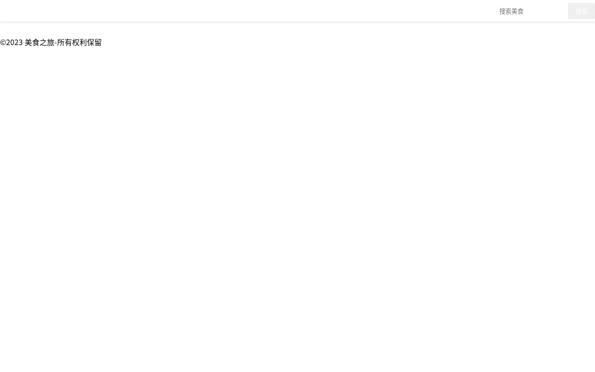

# heelo

Repository for uploaded code

## 目录结构

```
Helloworld/Helloworld/src/   # 「美食之旅」静态网站（HTML + CSS + 原生 JS）
  index.html                 # 首页（横幅 + 本周热门推荐）
  categories.html            # 美食分类
  featured.html              # 本周推荐（按评分排序）
  about.html                 # 关于我们
  detail-1.html ~ detail-4.html  # 美食详情页（食材、步骤、评分表单）
  styles.css                 # 全站样式
  script.js                  # 数据 + 路由 + 页面渲染
  images/                    # 菜品图片占位（SVG）
```

## 如何运行

这是一个纯静态站点，不需要构建，任选一种方式启动：

```bash
# 方式 1：Python 内置服务器（推荐）
cd Helloworld/Helloworld/src
python3 -m http.server 8000
# 浏览器打开 http://127.0.0.1:8000/index.html

# 方式 2：Node
npx serve Helloworld/Helloworld/src
```

> 直接双击 `index.html`（`file://` 协议）也能打开，但推荐用本地服务器，行为与线上一致。

## 运行效果

截图见 `docs/screenshots/`：

| 页面 | 截图 |
| --- | --- |
| 修复前（原样运行） |  |
| 首页 |  |
| 美食分类 |  |
| 本周推荐 |  |
| 美食详情 |  |
| 移动端首页 |  |

## 已修复的问题（相对上传版本）

**HTML (`index.html`)**
- `<script src="js/main.js">` 指向不存在的文件（实际脚本是 `script.js`）→ 改为 `script.js`。
- 补齐导航里引用但缺失的页面：`categories.html`、`featured.html`、`about.html`、`detail-1~4.html`。

**JS (`script.js`)**
- 所有模板字符串缺少反引号 `` ` ``，`<section class = "banner" >` 等 HTML 直接写在 JS 里 → 语法错误，整个脚本无法执行。
- 模板字符串里的标签没有加引号（`<section`、`<h1>`、`<div>`、``、`<li>` 等）且用了 `</search>` 这种错误闭合标签。
- `const name = document.querySelector('main')` 声明了 `name` 却使用 `main`（未定义）→ 改为 `main`。
- `.map(...)` 拼接后 `join(")` 是非法字符串 → 改为 `join("")`。
- 数据变量名 `foodDate` 与 `foos` 不一致，`if(!food)` 判断写反（导致详情页永远不渲染）→ 统一为 `food`，并把“找不到”的分支改成真正的兜底提示。
- 卡片链接写成 `herf="detail-${id}.html"=class="read-more"` → 改为 `href` + `class`。
- 路由里调用了不存在的 `loadCategoriesPage()` → 补充实现（按分类分组渲染）；同时补充 `loadFeaturedPage()`。
- 原本只有 1 条菜品数据，`slice(0,3)` 只能生成 1 张卡片 → 补充到 4 条数据。

**CSS (`styles.css`)**
- 颜色漏写 `#`：`color: 333`、`background: f9f9f9`、`background: FF7F50`、`background: 8B4513` 等 → 全部补上 `#`。
- `padding: 1 rem 2 rem` 中间有空格，不是合法长度 → 改为 `1rem 2rem`。
- `@media(min-width: 768px;)` / `@media(max-width: 768px;)` 括号内多了分号 → 媒体查询失效，改为 `@media (min-width: 768px)`。
- 补上 JS 生成的 `banner` / `featured` / `page-title` / `category-section` / `food-category` / `food-rating` 以及详情页表单、页脚的样式。

**资源**
- 缺失 `images/hotpot.jpg` 等图片（原路径会 404）→ 新增 4 张 SVG 占位图（`images/*.svg`），后续替换成真实照片即可。

## 备注

- 详情页通过文件名路由（`detail-<id>.html`），新增菜品时需要同时新增对应的 HTML 文件。
- 评分表单目前只做前端提示（`alert`），未接入后端存储。
